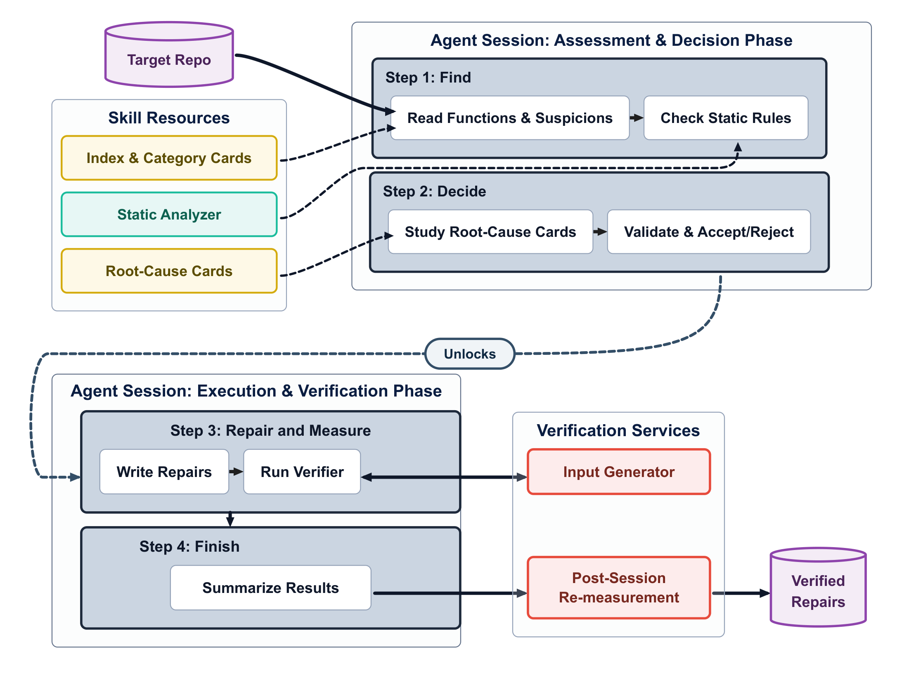

# Dr. Greens

**Find and repair energy smells in Python code with Claude Code.**

Dr. Greens is an agent skill: a folder you copy into your project, which Claude
Code loads when you ask it to look for energy waste. The agent reads your code,
finds **energy smells** (code that does more work than its task requires),
writes a repair for each one, and has every repair checked for identical
behaviour and measured for energy on your machine. It never edits your code;
you choose which measured repairs to apply.

## Abstract

```
Energy smells are inefficient implementations that waste energy. Once code
reaches production, they become costlier and riskier to fix, so energy checks
should shift left, i.e., move earlier in the development lifecycle, to where
code is written. Existing energy smell tools rely on fixed static rules and do
not measure energy savings, while LLM-based optimizers mostly target execution
time and rarely ground their changes in concrete smell definitions. We present
Dr. Greens, an agent skill that detects and repairs energy smells in Python
code inside the developer's coding environment. The skill grounds the coding
agent in our taxonomy of 12 energy smells and 65 root causes, extended with
repair guidance from 230 measured cases. The skill also encapsulates a static
analyzer and an independent verifier to confirm behavior preservation and
energy saving for each attempted repair. We evaluated Dr. Greens in 18
sessions on three open-source repositories, with two models and three skill
configurations. Of the 258 measured repairs, 68.6% save energy, with a median
saving of 24.9%. The taxonomy increased the number of units found with energy
smells on all three repositories and with both models, compared with a
baseline skill without it. Dr. Greens helps developers detect energy hotspots
and fix them reliably without impacting their behavior; the availability of
such a tool will enable energy-efficient code development.
```

<p align="center">
  
</p>
<p align="center"><em>Overview of Dr. Greens (<a href="docs/overview.pdf">PDF</a>).</em></p>

## Why Dr. Greens

- **Copy one folder.** The skill is a plain folder you copy into your project's
  `.claude/skills/`. No plugin, no server, no build step.
- **Any Python project.** It assumes no domain, framework or platform: it works
  on any repository whose code runs.
- **Minimal installation.** One `pip install` in your project's venv and one
  script that starts the input generator.


This repository accompanies the paper *Ctrl+Shift+Left: Detecting and
Refactoring Energy Smells using Agent Skills* (Mohammadjavad Mehditabar,
Saurabhsingh Rajput, Tushar Sharma; Dalhousie University).

- [Abstract](#abstract)
- [Why Dr. Greens](#why-dr-greens)
- [How it works](#how-it-works)
- [Requirements](#requirements)
- [Usage](#usage)
- [The three skills](#the-three-skills)
- [Reproducing the evaluation](#reproducing-the-evaluation)
- [Repository layout](#repository-layout)
- [Citation](#citation)

## How it works

The agent follows four steps:

1. **Find.** It reads every function in the target and lists each suspected energy smell.
2. **Decide.** It accepts or rejects each suspicion after studying it in depth.
3. **Repair and measure.** It writes a repair for each accepted suspicion. A
   verifier runs the original and the repaired function on the same inputs,
   checks that they behave identically, and measures the energy of both.
4. **Finish.** It summarises every repair, its root cause and its verdict.

The inputs a repair is measured on are written by a separate **input
generator**, which uses an LLM (DeepSeek V4.1 Flash through OpenRouter). It
runs outside the Claude Code session, so the agent cannot choose the inputs its
own repairs are measured on.

## Requirements

| | |
|---|---|
| Operating system | Linux on an Intel CPU, with readable RAPL energy counters |
| Python | 3.10 or newer, in the project's venv |
| Agent | [Claude Code](https://docs.claude.com/en/docs/claude-code), installed and signed in |
| Input generator | an [OpenRouter](https://openrouter.ai/keys) API key; inputs cost about a quarter of a cent per function |

If the RAPL counters are readable only by root:
`sudo chmod a+r /sys/class/powercap/intel-rapl:[0-9]*/energy_uj`.
Energy is read for the whole CPU package, so measure on an otherwise idle machine.

## Usage

**Set up one folder** that holds your project, the release and your key:

```
work/
├── my-project/         your project
├── dr-greens.zip       download it from this repository (the file dr-greens.zip, then "Download raw file")
└── openrouter-key      a text file holding only your OpenRouter key, on one line
```

Run every command below from `work/`, and replace `my-project` with your
project's folder name.

**Once per machine**, tell Claude Code where the input generator listens, then
open a new terminal:

```bash
echo 'export ENERGY_INPUTS_SOCKET="$HOME/.energy-skill/inputs.sock"' >> ~/.bashrc
```

**1. Unzip the release.**

```bash
unzip dr-greens.zip
```

**2. Copy a skill into your project.** Claude Code loads skills from `.claude/skills/`:

```bash
mkdir -p my-project/.claude/skills
cp -r dr-greens/skills/full/energy-smells my-project/.claude/skills/
```

The other skills are `dr-greens/skills/core+tax/energy-smells` and
`dr-greens/skills/core/energy-efficiency` ([which to choose](#the-three-skills)).
Install one skill at a time.

**3. Add the skill's packages to your project's venv.** The skill runs and
measures your code in that venv:

```bash
source my-project/.venv/bin/activate          # your project's venv
pip install -r dr-greens/requirements-skill.txt
```

No venv yet? Create one first with `python3 -m venv my-project/.venv`, activate
it, and install your project's dependencies (for example
`pip install -r my-project/requirements.txt`).

**4. Start the input generator** (with the venv still active), and leave this
terminal open while you use the skill. It stops when you close the terminal or
press Ctrl-C.

```bash
dr-greens/start_generator.sh my-project openrouter-key
```

**5. Open Claude Code** in another terminal, with your venv activated:

```bash
cd my-project
source .venv/bin/activate        # your project's venv
claude
```

Then ask, for example:

```
Find the energy smells in this repository using the energy-smells skill.
Find the energy smells in src/parser.py using the energy-smells skill.
```

With the `core` skill, ask: `Find where this repository wastes energy, using the
energy-efficiency skill.` Choose any Claude model with `/model`.

**6. Read the results.** The agent does not change your code. It writes four
files in your project: `step1.jsonl` (what it suspected), `step2.jsonl` (what
it accepted or rejected, and why), `step3.jsonl` (what became of each accepted
suspicion) and `submissions.jsonl` (one repair per line, with its verdict in
`agent_measurement.status`).

| Verdict | Meaning |
|---|---|
| `confirmed` | saves energy on every input |
| `partial` | saves energy on some inputs, no measurable change on the others |
| `mixed` | saves on some inputs, costs more on others |
| `regressed` | costs more on every input that changed |
| `negligible` | no change beyond the measurement noise |
| `inconclusive` | the machine was too noisy to resolve the effect |

Repairs that could not be measured are `not_equivalent` (behaviour differs),
`no_inputs` (no inputs could be generated, for example because the code needs
the network), `invalid`, `error` or `over_limit`. A session measures at most 20
repairs; other accepted suspicions are recorded as `deferred`.

**7. Apply the repairs.** For each function, `apply.sh` writes the `confirmed`
repair with the largest saving into your code:

```bash
dr-greens/apply.sh my-project
```

| Option | Effect |
|---|---|
| `--only ID ...` | only these repairs (their `id` in `submissions.jsonl`), or functions (`path/to/file.py::function`) |
| `--remeasure` | measure every repair again before choosing (about a minute each) |
| `--dry-run` | only write the report, change no code |

It writes `REPORT.md` in your project, listing every repair and whether it was
applied. Only `confirmed` repairs are applied, at most one per function. Check
the change with `git diff` and run your tests.

## The three skills

Each skill adds a layer of knowledge to the one before it. All three follow the
same four steps and use the same verifier, energy probe and input generator.

| Skill | Folder | Adds |
|---|---|---|
| `core` | `skills/core/energy-efficiency` | the procedure, the energy probe, the input generator and the verifier |
| `core+tax` | `skills/core+tax/energy-smells` | a taxonomy of 12 energy smells and 65 root causes: an index, 12 category cards, and 65 root-cause cards with measured repair examples and near-misses |
| `full` | `skills/full/energy-smells` | a static analyzer: 40 rules of our own and 31 Ruff rules, each mapped to root causes |

```
energy-smells/
├── SKILL.md               the procedure the agent follows
├── reference/             taxonomy index, category and root-cause cards, verification guide, output format
└── scripts/
    ├── step.py            marks a step as finished
    ├── scan.py            static rules (full only)
    ├── inputs.py          requests inputs from the input generator
    ├── verify.py          checks behaviour and measures the energy of each repair
    ├── energy.py          measures the energy of any call, at any step
    └── lib/               shared code
```

## Reproducing the evaluation

The evaluation ran each skill with Claude Sonnet 5.5 and Claude Haiku 5.5, at
high reasoning effort, on three open-source repositories: 18 sessions. Every
recorded session is in [`results/`](results/README.md). Reproducing it needs
this whole repository, an Anthropic API key, and about 25 GB of free disk space.

| Repository | Commit | Domain |
|---|---|---|
| `vespa-engine/sample-apps` | `e2ed22d` | search application samples |
| `dnanexus/dx-toolkit` | `accd86a` | genomics cloud toolkit |
| `open-telemetry/community` | `910f85d` | project automation scripts |

**1. Clone the repository**, anywhere, and run the commands below from inside it:

```bash
git clone https://github.com/SMART-Dal/Energy-Smell-Detection-with-Agents-Skills.git
cd Energy-Smell-Detection-with-Agents-Skills
```

**2. Save the keys.** The harness reads two key files from `~/energy-exp`
(set `ENERGY_EXP` to use another folder), each holding only the key:
`api-key` (an Anthropic API key, from [console.anthropic.com](https://console.anthropic.com))
and `openrouter-key` (an OpenRouter key).

```bash
mkdir -p ~/energy-exp && chmod 700 ~/energy-exp
nano ~/energy-exp/api-key            # paste the Anthropic key, save, exit
nano ~/energy-exp/openrouter-key     # paste the OpenRouter key, save, exit
chmod 600 ~/energy-exp/*-key
```

The agent never sees the keys: this folder is locked while a session runs.

**3. Set up.** Clones each repository at its commit and builds one venv per repository:

```bash
./setup.sh                      # or only one repository's venv: ./setup.sh community
```

**4. Run.**

```bash
./run.sh --check                                          # Claude Code starts (one short call)
./run.sh --dry-run --repos community                      # the whole pipeline without Claude
./run.sh --repos community --skills full --models haiku   # one session
./run.sh                                                  # all 18 sessions
```

| Option | Values | Default |
|---|---|---|
| `--repos` | names from `experiment/repos.tsv` | all three |
| `--skills` | `core`, `core+tax`, `full` | all three |
| `--models` | `sonnet`, `haiku`, `opus` | `sonnet haiku` |
| `--again` | run a finished session again (the earlier one is kept) | |

Sessions run one at a time on the same machine. Each lasts up to 2 hours,
followed by up to 40 minutes in which every repair is measured again. Finished
sessions are skipped, so running the same command again resumes. To keep a run
alive after you log out: `tmux new -d -s exp ./run.sh`.

**5. Results.** Each session is saved in
`~/energy-exp/archive/<repo>/<skill>/<model>/`, with one row per session in
`~/energy-exp/archive/summary.csv`, in the same layout as
[`results/`](results/README.md). Agents are not deterministic, so a new session
finds and repairs different code than the recorded one, and energy readings
depend on the hardware. The harness is described in
[`experiment/README.md`](experiment/README.md).

## Repository layout

```
.
├── dr-greens.zip          the release: the skills, start_generator.sh and apply.sh
├── dist/                  the three skills (skills/ in the release), generated by build/
├── src/                   the skills' scripts: verifier, static analyzer, energy meter
├── taxonomy/              the energy smell taxonomy (12 smells, 65 root causes)
├── catalog/               per root cause: patterns, measured repairs, near-misses
├── build/                 renders the taxonomy, catalog and templates into dist/
├── tools/
│   ├── inputs/            the input generator and its service
│   ├── review.py          chooses, re-measures and applies repairs (used by apply.sh)
│   └── make_bundle.sh     builds dr-greens.zip
├── experiment/            the evaluation harness (run_all.sh, config.sh, repos.tsv)
├── results/               every recorded session of the evaluation
├── validation/            measured repair cases behind the cards, near-miss specimens
├── tests/rules/           tests of every static rule
├── data/manual_sampling/  hand-written before/after sample pairs
├── docs/                  the overview figure
├── start_generator.sh     starts the input generator for a project
├── apply.sh               applies repairs to a project
├── setup.sh, run.sh       reproduce the evaluation
├── requirements.txt       packages of the harness and the build
└── requirements-skill.txt packages the skill needs in a project's venv
```

To rebuild the skills from their sources:
`pip install -r requirements.txt && python -m build`.

## Citation

Mohammadjavad Mehditabar, Saurabhsingh Rajput, and Tushar Sharma.
*Ctrl+Shift+Left: Detecting and Refactoring Energy Smells using Agent Skills.*
